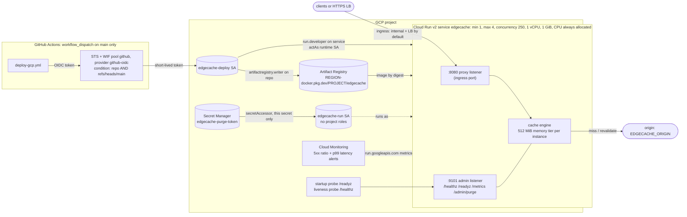

# Deploying edgecache to Google Cloud Run

Terraform for a Cloud Run v2 service, its Artifact Registry repo, a least-privilege runtime identity,
Workload Identity Federation for GitHub Actions and two alert policies, plus a manual-only deploy
workflow. **None of it has been applied.** The container was built and smoke-tested locally; the
Terraform and the workflow were validated and linted, never run against a real project. The table
under [What was run vs only validated](#what-was-run-vs-only-validated) says exactly which is which.

## Architecture



| File | What it defines |
|---|---|
| `terraform/versions.tf` | Terraform >= 1.9, `hashicorp/google ~> 8.5` (lock file pins 8.5.0 for linux/windows/darwin), partial `gcs` backend |
| `terraform/main.tf` | API enablement, Artifact Registry Docker repo with cleanup policies, runtime SA, purge-token secret + its one IAM grant, commented Serverless VPC Access connector |
| `terraform/cloudrun.tf` | the Cloud Run v2 service, probes, env, optional `allUsers` invoker |
| `terraform/wif.tf` | WIF pool + GitHub OIDC provider, deployer SA and its three resource-scoped grants |
| `terraform/monitoring.tf` | optional email channel, 5xx-ratio and p99-latency alert policies |
| `terraform/outputs.tf` | the values the workflow needs as repository variables |
| `../../.github/workflows/deploy-gcp.yml` | build, push to Artifact Registry, `gcloud run deploy` by digest |
| `../compose.smoke.yaml`, `../smoke.sh` | the local container smoke test |

## Service settings and why

| Setting | Value | Reason |
|---|---|---|
| CPU always allocated (`cpu_idle = false`, instance-based billing) | on | edgecache does work outside the request that caused it: a collapse leader keeps fetching after its client disconnects (orphan fetch), `stale-while-revalidate` and range-fill refreshes run after the response is sent, and the janitor ticks every 30 s (tombstones, tag-index reconcile, gauges). With request-based billing Cloud Run throttles CPU between requests, so all of that would stall until the next request. Instance-based billing is also the cheaper rate per vCPU-second (see costs). |
| `max_instance_request_concurrency` | 250 | A hit costs ~7 us of handler CPU (`BenchmarkHandlerHit`) and a miss mostly waits on the origin, so 1 vCPU carries far more than the default 80 in flight. Cloud Run scales out on concurrency, and every scale-out is a cold cache, so a high ceiling keeps traffic on the warm instance. Lower it if p99 rises under CPU saturation. |
| min / max instances | 1 / 4 | One instance keeps one warm cache (scale-to-zero empties it). The max is small on purpose: each instance has its own cache, so N instances means up to N origin fetches per object and a hit ratio that drops as traffic spreads. |
| CPU / memory | 1 vCPU / 1 GiB | `EDGECACHE_MEM_BYTES=512MiB` leaves the other half for the Go heap, buffers and in-flight bodies; `GOMEMLIMIT=900MiB` makes the GC tighten before the instance is killed for exceeding its limit. |
| Disk tier | off (`EDGECACHE_DISK_DIR=""`) | Cloud Run's writable filesystem is in-memory and counts against the same limit, so a disk tier there would be a second copy in RAM. |
| `startup_cpu_boost` | on | shorter cold starts (the binary starts in milliseconds; this mostly helps the first misses). |
| Startup probe | HTTP `GET /readyz` on :9101, every 1 s, 30 failures allowed | the admin listener only answers after the store is open and the proxy listener is bound (`cmd/edgecache/main.go` binds proxy, then admin), and `/readyz` goes 503 at teardown stage 1. |
| Liveness probe | HTTP `GET /healthz` on :9101, every 15 s, timeout 2 s, 3 failures | process liveness only: it never touches the origin, so an origin outage cannot make Cloud Run restart (and empty) a healthy cache. |
| Admin listener | `0.0.0.0:9101` + `EDGECACHE_PURGE_TOKEN` from Secret Manager | the probes need it off loopback; Cloud Run routes outside traffic only to the ingress port, and `config.Validate` refuses a non-loopback admin address without a token anyway. |
| `SHUTDOWN_TIMEOUT` | 8s | Cloud Run gives 10 s between SIGTERM and SIGKILL; the staged teardown's proxy drain (stage 2) has to fit inside it. |
| Request timeout | 60 s | matches `EDGECACHE_ORIGIN_TIMEOUT`. |
| Ingress | `INGRESS_TRAFFIC_INTERNAL_LOAD_BALANCER` (variable) | the intended production shape is an external HTTPS LB in front (TLS, Cloud Armor, optional Cloud CDN); `INGRESS_TRAFFIC_ALL` + `allow_unauthenticated = true` for a directly public cache. |
| Image | ignored by Terraform after create | CI owns the image (`gcloud run deploy --image ...@sha256:...`); Terraform owns every other setting. |

**Identities (least privilege).** The runtime SA `edgecache-run` has no project-level role; its only
grant is `secretAccessor` on the one purge-token secret (image pulls are done by the Cloud Run service
agent; stdout logs and the built-in request metrics need no grant). The deployer SA `edgecache-deploy`
also has no project-level role: `artifactregistry.writer` on the one repo, `run.developer` on the one
service, `iam.serviceAccountUser` on the runtime SA only. GitHub reaches it through WIF; the provider's
attribute condition only accepts tokens whose `repository` is `crowbett/edgecache` **and**
whose `ref` is `refs/heads/main`, so forks and branches cannot even get a federated token. There are no
JSON keys anywhere. The purge-token value is added with `gcloud secrets versions add` and never enters
Terraform state.

**Alerts.** Both use Cloud Run's own metrics (`run.googleapis.com/request_count` with
`response_code_class`, `run.googleapis.com/request_latencies`), not edgecache's `/metrics`, so they work
without a Prometheus scraper. Caveats: Cloud Run counts origin 5xx that the proxy passes through, and its
latency includes every miss's origin round trip; at very low traffic a single 5xx can trip the 5 % ratio.

## What was run vs only validated

| Item | Status | Evidence |
|---|---|---|
| Production image build (multi-stage, `CGO_ENABLED=0 -trimpath -ldflags "-s -w"`, distroless static nonroot) | **ran locally** | `docker compose -f deploy/compose.smoke.yaml build`, Docker Desktop 29.8.0 (WSL2), image 31.9 MB, `User` = `nonroot:nonroot` |
| Container smoke test (slow-origin -> edgecache -> curl, Cloud Run listener layout, read-only rootfs) | **ran locally, passed** | transcript below and in [`../smoke-output.txt`](../smoke-output.txt) |
| `terraform fmt -check -recursive` | ran, clean | Terraform 1.16.4 |
| `terraform init -backend=false` + `terraform validate` | ran, "Success! The configuration is valid." | google provider 8.5.0 |
| `tflint` with `tflint-ruleset-google` 0.40.0 and the terraform ruleset (`preset = "all"`) | ran, 0 issues | TFLint 0.64.0 |
| `actionlint` on `deploy-gcp.yml` (and `ci.yml`) | ran, 0 errors | actionlint 1.7.12, shellcheck integration on |
| `shellcheck -s sh deploy/smoke.sh` | ran, clean | |
| `terraform plan` / `apply`, the workflow, any GCP API call | **never run** | no project, no credentials, nothing created, nothing spent |
| Cloud Run probes on a port other than the ingress port | **not verified live** | the provider schema documents probe `port` as any container port, and `validate` accepts it; the Cloud Run console guide says to specify "the container port used for your service". If the API rejects 9101, switch the startup probe to `tcp_socket { port = 8080 }` and drop the HTTP liveness probe (the proxy port has no health path of its own, by design). |

Smoke test transcript (2026-10-01, `docker compose -f deploy/compose.smoke.yaml up --build --abort-on-container-exit --exit-code-from smoke`, exit 0):

```
readyz: {"status":"ready"}
healthz: {"status":"ok"}
GET /obj/42 #1 X-Cache: MISS
GET /obj/42 #2 X-Cache: HIT
origin hits: {"total":1,"not_modified":0,"keys":{"42":1}}
metrics:
edgecache_requests_total{outcome="hit"} 1
edgecache_requests_total{outcome="miss"} 1
edgecache_requests_total{outcome="stale"} 0
edgecache_requests_total{outcome="revalidated"} 0
edgecache_requests_total{outcome="bypass"} 0
edgecache_requests_total{outcome="error"} 0
edgecache_origin_requests_total{status_class="1xx"} 0
edgecache_origin_requests_total{status_class="2xx"} 1
...
edgecache_build_info{go_version="go1.27.1",version="smoke"} 1
purge: {"purged":1,"kind":"prefix"}
GET /obj/42 #3 (after purge) X-Cache: MISS
SMOKE OK
```

Run it yourself: `docker compose -f deploy/compose.smoke.yaml up --build --abort-on-container-exit --exit-code-from smoke`,
then `docker compose -f deploy/compose.smoke.yaml down`.

## Using it (when there is a project to use it on)

```bash
cd deploy/gcp/terraform
cp terraform.tfvars.example terraform.tfvars        # project_id, origin_url, ...
terraform init -backend-config="bucket=<project>-tfstate" -backend-config="prefix=edgecache"
terraform plan -out tf.plan && terraform apply tf.plan
openssl rand -hex 32 | gcloud secrets versions add edgecache-purge-token --data-file=-
terraform output   # -> GitHub repository variables GCP_WIF_PROVIDER, GCP_DEPLOY_SA, GCP_AR_REPO (+ GCP_PROJECT_ID, GCP_REGION)
```

Then run **Actions -> deploy-gcp -> Run workflow** on `main`. The first apply runs Google's public hello
image (the secret has to exist before an edgecache revision can start); the first workflow run replaces it.

## Cost estimate

Monthly, us-central1 (Tier 1), list prices in USD, 730-hour month, no committed-use discount. Unit prices
were read from the GCP pricing pages on 2026-10-01 (links below); the usage figures are assumptions, not
measurements.

| Line item | Unit price (source) | Assumed usage | Est. / month |
|---|---|---|---:|
| Cloud Run, instance-based billing: CPU | $0.000018 / vCPU-s; first 240,000 vCPU-s free [1] | 1 instance x 1 vCPU x 2,628,000 s | $47.30 - $4.32 free = **$42.98** |
| Cloud Run, instance-based billing: memory | $0.000002 / GiB-s; first 450,000 GiB-s free [1] | 1 GiB x 2,628,000 s | $5.26 - $0.90 free = **$4.36** |
| Cloud Run requests | none under instance-based billing [1] | any | $0 |
| Each extra instance while scaled out (max 4) | same rates | per instance-month | +$52.56 |
| Artifact Registry storage | first 0.5 GiB free, then $0.000136986 / GiB-hour (~$0.10 / GiB-month) [2] | 10 kept images x ~32 MB | $0 |
| Secret Manager | 6 active versions + 10,000 accesses free, then $0.03 / 10k accesses [3] | 1 version, one access per instance start | $0 |
| Cloud Monitoring alerting | $0.35 / month per metric reference in an alert policy, **billing starts 2027-09-01** [4] | 3 references (5xx numerator + denominator, latency) | $0 now, $1.05 from Sept 2027 |
| Internet egress, Premium Tier, to North America | first 1 GiB free, $0.12 / GiB up to 1 TiB [5] | 100 GiB served to clients | **$11.88** |
| **Total, 1 warm instance + 100 GiB egress** | | | **~$59 / month** |

For comparison, the configurations this repo does **not** use:

| Alternative | Est. / month | Why not |
|---|---:|---|
| Request-based billing, min 0 (scale to zero), hobby traffic (~50 h of billed instance time, < 2 M requests) | ~$0 (inside the request-based free tier: 180,000 vCPU-s, 360,000 GiB-s, 2 M requests [1]) | every scale-from-zero starts with an empty cache, and CPU is throttled outside requests, so orphan fetches, SWR refreshes and the janitor stall |
| Request-based billing, min 1 kept warm | idle rate $0.0000025 / vCPU-s and / GiB-s [1]: ~$13 idle + active time at $0.000024 / vCPU-s, $0.0000025 / GiB-s, $0.40 / M requests | same CPU-throttling problem; cheaper only while the instance is mostly idle |

Egress, not compute, dominates once the cache actually serves traffic: at 1 TiB/month the egress line
is ~$123 against ~$47 of compute. An external HTTPS load balancer (needed for the default ingress
setting, plus TLS on a custom domain and Cloud Armor) adds forwarding-rule and data-processing charges
not in the table.

Sources (fetched 2026-10-01):
[1] https://cloud.google.com/run/pricing ·
[2] https://cloud.google.com/artifact-registry/pricing ·
[3] https://cloud.google.com/secret-manager/pricing ·
[4] https://cloud.google.com/stackdriver/pricing ·
[5] https://cloud.google.com/vpc/network-pricing

## Honest notes: a cache on serverless

Cloud Run is a reasonable way to run edgecache for a demo or a modest origin. It is a poor fit for a
cache that is supposed to be big, shared or durable, and the configuration above is a set of trade-offs
around that rather than a fix:

- **Scale to zero empties the cache.** The memory tier lives in the instance; when Cloud Run removes the
  last instance every object is a miss again. `min_instances = 1` is the cheap fix (~$47/month for one warm
  1 vCPU / 1 GiB instance) and is the default here. Even then, a new revision (every deploy) starts cold.
- **Every instance is its own cache.** Cloud Run does not route by URL, so with N instances an object can
  be fetched from the origin N times, the effective hit ratio falls as traffic spreads, and memory is used
  N times for the same hot set. Keeping `max_instances` low and concurrency high limits this.
- **Purge only reaches one instance.** `PURGE` on the ingress port lands on whichever instance Cloud Run
  picks, and the admin listener is not reachable from outside. With more than one instance a purge is
  incomplete until the entry expires. If purge correctness matters, pin `max_instances = 1` or move the
  cache to a shared tier.
- **No real disk tier.** The diskstore was built for a local disk (temp + fsync + rename, scan at boot);
  Cloud Run's filesystem is RAM. Cloud Storage FUSE does not give the rename and fsync guarantees it relies
  on, and Filestore (NFS) is far more expensive than the problem warrants.
- **What I would do for a real deployment:** for a shared, purge-consistent cache, a Memorystore for
  Redis tier behind edgecache's `tiered.Tier` port (edgecache has **no Redis tier today**; it would be a new
  `internal/` store implementing the existing port), or run edgecache on GKE / a managed instance group
  with local SSD so the disk tier does what it was designed for, with URL-hash load balancing to shard the
  keyspace. If edge latency is the goal rather than origin offload, Cloud CDN in front of the HTTPS load
  balancer does the global part and edgecache stays a regional shield.
- **Other gaps found while writing this:** `X-Forwarded-Proto` from Google's front end is ignored unless
  the peer is listed in `EDGECACHE_TRUSTED_PROXIES`, so every entry is keyed as `http` (harmless for a
  single-scheme service, wrong if one URL is served on both schemes). slog's JSON uses `level`, while Cloud
  Logging reads `severity`, so every log line lands as `DEFAULT` severity until the handler maps the key.
